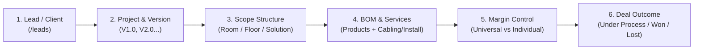

# TaskPro Quotation & CPQ Portal — Comprehensive System Plan & Technical Reference

**Company:** Tasktel Technologees Pvt Ltd  
**Application:** TaskPro Quotation (Sales & CPQ Module)  
**Version:** 1.0 (Production Release)  
**Port:** 3000 (Local: `http://localhost:3000`, Network: `http://172.20.10.2:3000`)

---

## 1. Executive Summary

TaskPro Quotation is an enterprise Configure, Price, Quote (CPQ) and Proposal Management Portal built specifically for **Tasktel Technologees Pvt Ltd**. It mirrors the design language, color scheme, and clean user experience of the **TaskTel Ticket Portal**, and implements exact mathematical AV costing matching Tasktel's ground-truth Excel workbook (`Tasktel - Internexus- Reliance-AV Communication Solution Costing cum Proposal v1.0 -04-10-26.xlsx`) to the rupee.

---

## 2. Tech Stack & Architecture

- **Framework:** Next.js 15.5.29 (App Router)
- **UI Library:** React 19.3.1
- **Language:** TypeScript 5.9.3 (Strict Type Checking)
- **Styling:** Tailwind CSS 3.4.19 with custom TaskTel color tokens
- **Spreadsheet Processing:** SheetJS (`xlsx` 0.18.5) for bidirectional Excel import/export
- **Iconography:** `lucide-react`
- **Hosting / Network:** Node.js standalone daemon server listening on `0.0.0.0:3000` for both local and LAN (mobile/tablet/laptop) access.

---

## 3. Brand Identity & Design System

The portal adheres strictly to the TaskTel Brand Guidelines (`BRAND_COLORSd.md`):

| Token | Hex Value | Usage |
|---|---|---|
| **Primary Brand** | `#004898` | TaskTel Royal Blue (Buttons, active states, key financial totals) |
| **Hover Shade** | `#003774` | Button hover states, active pill toggles |
| **Light Tint** | `#e6f0fa` | Active sidebar backgrounds, subtle badge fills |
| **Canvas Background** | `#f8fafc` | Main page canvas background |
| **Card Background** | `#ffffff` | Clean white cards with `border-slate-200` |

### Pipeline Stage Color Tokens (Leads & CRM)
- **New Lead:** `#004898` (TaskTel Blue)
- **Meeting:** `#ea580c` (Vibrant Orange - 10-day SLA)
- **Proposal:** `#4f46e5` (Indigo - 7-day SLA)
- **Funnel:** `#0d9488` (Deep Teal)
- **Follow-up:** `#d97706` (Warm Amber - 10-day SLA)
- **Won:** `#059669` (Emerald Green - Closed Won)
- **Lost / Dead:** `#e11d48` (Rose Crimson - Disqualified)

---

## 4. End-to-End Sales Flow (Notebook Workflow Specification)

The portal implements the unified 6-step lifecycle defined in the handwritten specifications:



### Step 1: Lead Capture & Conversion (`/leads`)
- New opportunities captured with Customer, Location, Value, and Stage.
- One-click **`+ Proposal (V1)`** button instantly opens the Quote Builder with pre-filled Client Name, Project Scope, and Salesperson.

### Step 2: Proposal Versioning (`V1.0, V2.0, ..., Vn`)
- Multiple revisions tracked under the same master quotation number (e.g., `TT-CHE-2627-0003`).
- Clicking **`+ Version`** increments the revision (e.g. `V2.0`), cloning all rooms, groups, and pricing lines while maintaining revision history.

### Step 3: Scope Breakdown (Room vs. Floor vs. Solution)
Quotations can be organized across three distinct structural types:
- **Room Scope:** e.g., *48 Seater Boardroom*, *Huddle Room 1*, *Training Room*.
- **Floor Scope:** e.g., *Ground Floor Main Lobby*, *1st Floor Executive Suite*.
- **Solution Scope:** e.g., *Digital Signage Network*, *Website - Experience Center AV Solution*.

### Step 4: Physical Equipment + Installation & Cabling Services
Inside every group:
- **`+ Add Product`**: Typeahead search through the 18 LG Displays, Neat, Kramer, Samsung catalogs.
- **`+ Install / Cabling`**: 1-click modal to append standard AV engineering charges:
  - `SVC-CABLELAY`: Concealed Cable Laying & Raceway Patching (₹4,500)
  - `SVC-WALL-MOUNT`: Heavy-Duty Commercial Display Wall Mounting & Rigging (₹6,000)
  - `SVC-INSTALL`: Professional On-site Installation, Rigging & Handover (₹10,000)
  - `SVC-COMMISSION`: DSP Audio Calibration & Acoustic Verification (₹15,000)
  - `SVC-HANDOVER`: End-to-End Testing & Administrator Handover Training (₹8,000)
- **UOM (Unit of Measure):** Every line specifies `Nos`, `Set`, `Mtr`, `Lot`, `Year`, or `Pkt`.

### Step 5: Universal Margin vs. Individual Line Margin
- **Universal Project Mode (`Universal calcl`):** Set a global Standard Multiplier (e.g. `SM = 0.85` = 15% margin) in the top configuration bar. All line item target prices auto-calculate.
- **Individual Line Mode (`Margin Individual`):** Click **"Show Costing Columns"** to override the SM or Quoted Unit Price on any individual line. The system flags lines as either `"Univ"` or `"Indiv"`.

### Step 6: Deal Status & Lifecycle
- **🟡 Under Process:** Deal under negotiation or awaiting client approval.
- **🟢 WON:** Opens modal to record customer Purchase Order (PO) number and PO date.
- **🔴 LOST:** Opens modal to record loss reason (Competitor price, budget cancelled, timeline mismatch).

---

## 5. Mathematical Costing Engine Specification

The costing engine (`src/lib/quote-engine.ts`) implements the verified Excel formulas:

$$\text{Line Amount} = \text{Qty} \times \text{Quoted Unit Price}$$
$$\text{Line GST Amount} = \text{Line Amount} \times \text{GST Rate (18\%)}$$
$$\text{Line Total} = \text{Line Amount} + \text{Line GST Amount}$$
$$\text{KP to Quote} = \frac{\text{OSP Unit}}{\text{SM}}$$
$$\text{Target Price} = \operatorname{ceil}\left(\frac{\text{KP to Quote}}{\text{Rounding Step}}\right) \times \text{Rounding Step}$$
$$\text{Room Total} = \left(\sum \text{Line Totals}\right) \times \text{Room Count}$$
$$\text{Overall Gross Margin ₹} = \text{Subtotal Amount (Excl. Tax)} - \text{Total OSP Cost}$$
$$\text{Overall Margin \%} = \frac{\text{Overall Gross Margin ₹}}{\text{Subtotal Amount}} \times 100$$
$$\text{Grand Total} = \text{Subtotal Amount} + \text{Total GST} + \text{Total Freight}$$

---

## 6. Pre-loaded LG Commercial Signage Catalog

All 18 models from the official LG pricing schedule are pre-loaded in `INITIAL_PRODUCTS`:

| Series | Model | Size | HSN Code | Default Unit OSP (₹) |
|---|---|---|---|---|
| **UL Series (24/7, ADS Panel)** | `43UL5Q` | 43" UHD | `85287219` | ₹31,000 |
| | `55UL5Q` | 55" UHD | `85287219` | ₹42,000 |
| | `65UL5Q` | 65" UHD | `85287219` | ₹61,000 |
| | `75UL5Q` | 75" UHD | `85287219` | ₹89,000 |
| | `86UL5Q` | 86" UHD | `85287219` | ₹1,52,000 |
| **UH Series (24/7, IPS Panel)** | `43UH5Q` | 43" UHD | `85285900` | ₹38,000 |
| | `55UH5Q` | 55" UHD | `85285200` | ₹49,000 |
| | `65UH5Q` | 65" UHD | `85287219` | ₹78,000 |
| | `75UH5J` | 75" UHD | `85285200` | ₹1,12,000 |
| | `86UH5J` | 86" UHD | `85285200` | ₹1,85,000 |
| | `98UH5J` | 98" UHD | `87089900` | ₹3,92,000 |
| **UM Series & Panoramic** | `98UM5J` | 98" UHD | `85285200` | ₹3,65,000 |
| | `110UM5K` | 110" UHD | `85285200` | ₹13,20,000 |
| | `110UM5K (21:9)` | 110" 5K Panoramic | `85285200` | ₹12,89,000 |
| **Interactive & Video Wall** | `105TR5WP` | 105" Touch Interactive | `85285200` | ₹8,20,000 |
| | `105BM5P` | 105" 21:9 Stretched | `85285200` | ₹5,80,000 |
| | `Video Wall 49"` | 49" Narrow Bezel | `85285900` | ₹1,45,000 |
| **Signage Software** | `SuperSign CMS` | Annual Cloud License | `997331` | ₹18,000 |

### Effortless Price Editing
1. **In Price List (`/price-list`):**
   - Click into any price box, type new price, press Enter. Auto-saves to `localStorage` (`taskpro_products_catalog`) with visual confirmation.
   - Click pencil icon to edit full specifications or HSN.
   - Excel Import/Export for mass price updates.
   - "Reset" button to revert to factory defaults.
2. **In Quote Builder (`/quotes/new`):**
   - Real-time sync with updated catalog prices.
   - Direct in-row price and OSP modification.

---

## 7. Role-Based Permissions & Demo Accounts

| Role | Username | Password | Full Name | Capabilities |
|---|---|---|---|---|
| **Admin** | `admin` | `admin@123` | Vishva (Admin Coordinator) | Full access, OSP costing visible, edit prices, approve margins, user admin |
| **Manager** | `manager` | `manager@123` | Dinesh (Regional Manager) | Full access, OSP costing visible, approve margin thresholds |
| **Sales** | `sales` | `sales@123` | Balasubramanian S (Sales Head) | Create quotes, OSP visible, cannot edit master price list |
| **Viewer** | `viewer` | `viewer@123` | Suresh Sir (Executive Director) | Client proposal view only (OSP costs & internal margins hidden) |

---

## 8. Complete Project File Manifest

All files in the project are verified, active, and strictly required:

```
C:\Task Pro Quotation\
├── public\
│   ├── logo.png               # Official TaskTel Brand Logo (Header & Sidebar)
│   └── logo-icon.png          # TaskTel Logo Icon
├── src\
│   ├── app\
│   │   ├── layout.tsx         # Global HTML wrapper with Google font setup
│   │   ├── globals.css        # CSS variables (--primary: #004898, hover, tint)
│   │   ├── page.tsx           # Dashboard with pipeline KPIs and quick actions
│   │   ├── login\page.tsx     # Authentication page with 1-click role cards
│   │   ├── leads\page.tsx     # Leads CRM with 7 pipeline stages and Excel import
│   │   ├── quotes\
│   │   │   ├── page.tsx       # Quotations directory (Versions, Won/Lost status)
│   │   │   └── new\page.tsx   # Quotation & CPQ Builder (Unified table, Room/Floor/Solution)
│   │   ├── price-list\page.tsx# LG Product Catalog with inline price editing & persistence
│   │   ├── customers\page.tsx # Customer & billing/shipping address master directory
│   │   ├── hsn\page.tsx       # HSN & SAC GST tax code registry
│   │   ├── terms\page.tsx     # Terms & Conditions proposal templates
│   │   ├── reports\page.tsx   # Quotation win/loss analytics & sales performance
│   │   ├── settings\page.tsx  # General company, freight & financial configurations
│   │   └── users\page.tsx     # User administration & role assignment
│   ├── components\layout\
│   │   ├── AppShell.tsx       # Auth provider, session persistence, role switcher
│   │   ├── Header.tsx         # Global search, meeting notification dropdown, user badge
│   │   └── Sidebar.tsx        # Responsive navigation, brand logo, role switcher, logout
│   ├── lib\
│   │   ├── quote-engine.ts    # Mathematical costing formula engine
│   │   ├── excel.ts           # Excel bulk import, export & sample template generator
│   │   ├── mock-data.ts       # LG catalog, initial customers, leads, quotes, users
│   │   └── utils.ts           # formatINR currency formatter & Tailwind merge
│   └── types\
│       └── index.ts           # TypeScript interfaces (Product, Lead, Quote, User, etc.)
├── package.json               # Next.js 15, React 19, Tailwind, SheetJS dependencies
├── tailwind.config.ts         # TaskTel color palette configuration
├── tsconfig.json              # TypeScript compilation rules
├── PLAN.md                    # System architecture and operational manual
└── pnpm-lock.yaml             # Pnpm dependency lockfile
```
