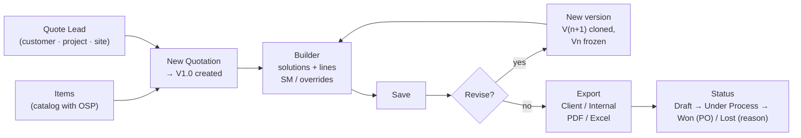

# Quotation Module (Quote Manager) — Technical Reference

**Company:** Tasktel Technologees Pvt Ltd
**Shipped in:** commit `9205e4c` — "Add Quotation module and Sales lead Funnel"
**Lives in:** the existing Admin/Technician portal (`ADMIN_TECHNICIAN/ADMIN DASH`) + `backend-unified`. It is **not** a separate app. No new server, port, or login.

---

## 1. What it is

A Configure-Price-Quote tool inside the Admin Dash. Quote Managers keep an item catalog with cost prices (OSP). They create quote leads (customer + project + site) and build versioned quotations from them. A quotation is organised into solutions, such as a room, floor or system. The selling price is calculated from cost using a Standard Multiplier (SM). Managers export a client copy (no cost or margin) or an internal copy (with cost and margin) as PDF or Excel. Each deal is then tracked to Won (with PO) or Lost (with reason).

**Leads and quotations are shared.** Every Quote Manager sees and works the same leads and quotations. Section 3a lists the rules that keep shared editing safe: unique leads, one quotation per lead, one editor at a time, freezing a version when it is issued, Super Admin approved deletes, and a history log.

The module is purely additive. It adds new tables, new routes and new pages, and it touches no existing table, column or constraint. **Quote leads are separate from Sales `leads`.** The two are never linked, and nothing in the module reads or writes the Sales pipeline.

---

## 2. Who can use it

Prices and margins are confidential, so only two kinds of session get in. Both are checked **live against the database on every request**, never trusted from the JWT (`backend-unified/middleware/quoteAuth.js`).

| Who | Mode | What they can do |
|---|---|---|
| Back-Office employee with the **Quote Manager** tag | `manager` | Full read/write: catalog, leads, quotes, versions, status, exports |
| **Super Admin** | `viewer` | Read-only view of everything, including exports. Assigns/removes the Quote Manager tag |
| Every other admin, Sales, Technician, Customer | — | Refused (403). No nav entry shown |

### Assigning a Quote Manager
1. The Super Admin opens **Back-Office** in the admin sidebar.
2. A **Quotations** column (visible only to the Super Admin) shows a **Quote Manager** toggle per employee.
3. Turning it on inserts a row in `quote_managers` (`PUT /api/quotes/managers/:backOfficeId`). Only active employees can be granted. Turning it off deletes the row. If the employee is removed, the grant is dropped too (`ON DELETE CASCADE`).

Other admins can never be given access. The `quotations` admin page maps to a module key that no `admin_permissions` row grants, so only the Super Admin passes `canAccessAdminPage`.

### How the UI decides what to show
- `GET /api/quotes/access` never returns 403. It returns `{ canAccess, mode }` and the UI uses that to show or hide the module.
- `useQuoteAccess()` (`quoteShared.js`) caches that answer per access token for the nav. The module pages pass `recheck: true` so that a grant or revoke made since login takes effect on the next page open.
- **Back-Office Quote Manager:** gets three extra nav entries in both the desktop Sidebar and the mobile BottomNav: **Quote Leads**, **Quotations** and **Items**.
- **Super Admin:** gets a single **Quotations** admin page with three tabs (Quotations / Quote Leads / Items) and a "Super Admin · view only" badge.

---

## 3. End-to-end workflow



### Step 1: Build the catalog (Items page)
- **Categories** are folders that items are filed under. You can create, rename and delete them; a category that still holds items can't be deleted. Names are unique, ignoring case.
- **Items** have Category, Series, **Model Name** (unique, ignoring case, and used as the item's identity), HSN code, **Price**, GST % (default 18) and Remark.
  - **Price is the cost (OSP)**, not the selling price. The selling price is worked out inside each quote.
- The list is searchable (model, series, HSN, remark, category), filterable by category, and paged at 50 rows. Rows can be multi-selected for bulk delete (up to 1000 at a time).
- **Excel import:**
  - **Download template** gives the columns `Category, Series, Model Name, HSN Code, Price, GST %, Remark`.
  - The header row is found automatically in the first 10 rows, so a title row can sit above it. Common alternate headers are accepted (e.g. `OSP`/`Cost` → Price, `HSN/SAC` → HSN Code, `Product` → Model Name).
  - A preview shows the row count, valid rows, rows with errors, and new categories that will be created.
  - The import is **all-or-nothing**: any invalid row rejects the whole file and every row's error is listed. Missing categories are created. An existing model name is **updated in place**. A model that appears twice in one file keeps the last row. The limit is 5000 rows per file.
- **Excel export** downloads the current catalog in the same column layout, so it can be edited and re-imported.
- Deleting an item never changes saved quotes. Each quote line keeps its own copy of the item's fields.

### Step 2: Create a Quote Lead (Quote Leads page)
- Fields: **Customer** (required), **Project** (required, free text), Location / Site, **Contact Person**, and **Account Manager** (a dropdown of active Sales employees). The manager's phone fills in automatically and prints on the quotation. Project is not linked to any other module.
- **A lead is unique on Customer + Project**, ignoring case and extra spaces (`Acme Corp` / `Board Room` = ` acme  corp` / `BOARD ROOM`). Creating or renaming into an existing pair is refused with *"A lead for … already exists"*, and **Show it** filters the list to that lead.
- The list shows the creator, the quotation's status and the last activity.
- A lead with a quotation can't be deleted.

### Step 3: Start a quotation
- **A lead has exactly one quotation.** Revisions are versions of it, not new quotations.
- **New Quotation** on a lead row creates the quote with **V1.0**. V1.0 starts with one empty solution, the default Notes and the default Terms & Conditions, and the builder opens on it straight away. After that the button becomes **Open Quotation**. If two managers click at once, the second is taken to the first one's quotation.
- The Quotations page's **New Quotation** button sends you to Quote Leads, because every quote must belong to a lead.

### Step 4: Build it (Quote Builder)

**Header settings (sticky bar):**
- **Project Ref**, free text (e.g. `TTPL/BLR/INS/AV/26-27/NRS/041026-a`).
- **Date** of the quotation.
- **Universal SM**, the Standard Multiplier for the whole quote (default `0.85`). The bar shows the matching margin (`0.85` → 15% margin).
- **Round up to** ₹1 / ₹10 / ₹100 / ₹1000 (default ₹100).
- **Costing** toggle, which shows or hides the OSP and SM columns, the margin column and the cost KPIs on screen. This only affects the screen; exports are chosen separately.
- **KPI tiles:** OSP Cost, Supply Price, Services Price, GST, Margin (₹ and %) and Grand Total.

**Solutions (sections):**
- Each solution has a free-text name (e.g. *48 Seater Boardroom*, *Ground Floor Lobby*, *Digital Signage Network*). This one structure covers rooms, floors and solutions.
- A solution's menu offers Move up/down, **Duplicate solution** (copies every line) and Delete.
- **Add item** opens a catalog picker with search plus a category filter. Use ↑/↓ and Enter to add, and the same item can be added more than once. The item's model, series, category, HSN, OSP, GST and remark are **copied** onto the line.
- **Add installation / service** adds a free-text service line with its own qty, OSP and GST.
- Within a solution, supply lines are listed first, then a divider, then **Installation & Services** lines.
- **Add Pre-Installation & PPM** adds at most one special block, "Pre-Installation Planning & Migration Services". Every line in it is a service line, and new solutions are always inserted above it.

**Per-line editing:**
- Qty, HSN, description, GST % and OSP Unit (when costing is shown).
- **SM override** on a line replaces the universal SM for that line.
- **Unit Price override:** typing a price fixes it, ignoring SM entirely.
- Lines with either override are tagged **Indiv**, the rest **Univ**. Clicking the *Indiv* tag clears both overrides and puts the line back on the universal SM.
- Lines can be reordered with the up/down arrows and removed.

**Terms & Conditions:** the **Terms & Conditions** button sits beside *Add Pre-Installation & PPM*. It opens an editor for the **delivery timeline** and the **terms text**. Both are saved with the version, copied into new versions, and printed after the Notes. New quotations start from `DEFAULT_TERMS` in `quoteService.js`.

**Below the solutions:**
- **Investment Summary:** one row per solution with Supply / Services / GST, then Grand Total (Supply + Installation + PPM), Grand Total (All Inclusive), and the SM margin row when costing is shown.
- **Notes:** free text saved with each version. New quotes start with eight default notes (`DEFAULT_NOTES`): civil/electrical, false ceiling, raceway/conduiting, IT infrastructure, cabling at actuals, racks/enclosures, power points/conduits, DTH.

**Saving:**
- **Autosave:** edits save automatically about 3 seconds after you stop typing. The badge shows *Saving… → All changes saved*, or *Not saved: reason*. Autosave waits while a freshly added line has neither an item nor a description.
- **Save** / **Ctrl/⌘ + S** saves immediately. The whole version (settings + solutions + lines) is sent and replaces what was stored.
- Closing the tab with unsaved edits warns first. Navigating to another page keeps unsaved edits in memory and restores them when you reopen that version, unless someone saved it in the meantime.
- **Conflict protection:** each save must send the `updated_at` that was loaded. If it doesn't match, the save is refused with *"Someone else saved this quotation while you were editing"* and you are offered a reload.

### Step 5: Versions (V1.0, V2.0, …)
- A version is either a **Draft** (editable) or **Issued** (sent to the client and frozen for good). Only the latest version can be a draft.
- **A Client PDF / Client Excel export of the draft issues it.** You are asked *"Issue V1.0 to the client?"*, and on yes the version is frozen and stamped with who issued it and when. **Internal exports never freeze.** To preview a draft without issuing it, use an Internal export.
- Re-exporting an issued version gives the same document, and no new version is made.
- An issued version stores the **customer / project / site it went out with**, so editing the lead later never changes an issued PDF.
- To revise an issued version, use **Start V(n+1).0** (shown on the issued banner) or **New version**. **New version** is always available on the latest version, so you can bump the version manually at any time. It copies the latest saved version, including SM, rounding, notes, solutions and lines, and pending edits are saved first. **The quote's status is kept**, so a revision of an Under Process quote stays Under Process.
- The **version picker** shows each version's total, a Draft / Issued / Read-only badge, who issued or last edited it, and which version **Won**.

### Step 6: Status / deal outcome
| Status | Label | Rules |
|---|---|---|
| `draft` | Draft | Default |
| `sent` | Under Process | With client / negotiating |
| `won` | Won | Requires **PO number** and **PO date** |
| `lost` | Lost | Requires a reason: Competitor price, Budget cancelled, Timeline mismatch, Scope changed, No response, or Other (free text) |

- **Mark Under Process** and **Mark Won** issue the latest version if it isn't issued yet (you are asked first). Won also records **which version won**.
- A **Won** or **Lost** quote is **locked**: it can't be saved and no new version can be made from it. **Reopen (Under Process)** unlocks it.
- **Deleting needs Super Admin approval.** **Request deletion…** in the Status menu asks for a reason. The quotation then shows *Deletion pending* and is frozen for everyone, and any manager can **Cancel request**. The Super Admin approves or rejects it from the **Delete requests** panel at the top of the Quotations page, or from the banner inside the quotation. Approving deletes every version. The lead stays, so a new quotation can be started from it.

### 3a. Shared-editing rules (migration `049_quote_sharing_rules.sql`)

| Rule | How it works |
|---|---|
| Unique leads | Unique index on `quote_lead_key(customer), quote_lead_key(project)`. Project is `NOT NULL`. |
| One quotation per lead | Unique index on `quotes.lead_id`. |
| One editor at a time | Opening an editable draft takes an **edit lease** (`quote_edit_locks`, 2 minutes). The builder renews it every 45 seconds while you've used the page in the last 5 minutes, and releases it when you leave. Everyone else sees *"Asha is editing this quotation right now"* and can only view. **Take over** replaces the lease. The previous editor's next save is refused, and they are told who took over. Every write (save, issue, status, new version, delete request) is refused while someone else holds a live lease. |
| Issue freezes | `quote_versions.issued_at` set. Saves to an issued version get a 409. |
| Delete approval | `quotes.delete_requested_*`. The approve / reject routes accept only the Super Admin. |
| History | `quote_events` records created, saved (consecutive saves by one person within 30 minutes collapse into one entry), issued, exported, new version, status changes, takeovers, and delete request / cancel / reject / approve. The **History** button in the builder shows it. Entries have no FK to `quotes`, so the trail of a deleted quotation survives. |
- The Quotations list shows each quote's latest version with Grand Total, Margin %, status and PO number. It has status tabs and status tiles (count and value per status) plus a search over customer, project and ref.

---

## 4. Costing engine

The same pure-function engine exists in two places, and both are pinned by `backend-unified/tests/quoteEngine.test.js`:
- `backend-unified/services/quoteEngine.js` computes the totals stored on save.
- `ADMIN DASH/src/components/quotes/quoteEngine.js` does the live math in the UI.

**Change one, change both.**

```
SM (effective)  = line.sm_override  ?? quote.sm
Unit Price      = line.price_override
                  ?? ceil( (OSP ÷ SM) / rounding_step ) × rounding_step      (0 if OSP ≤ 0)
Amount          = qty × Unit Price
GST             = Amount × gst_rate %
Line Total      = Amount + GST
OSP Total       = qty × OSP
Margin ₹        = Amount − OSP Total
Margin %        = Margin ₹ ÷ Amount × 100
```

Totals are kept per solution and for the whole version, split by line type:

```
supply_osp / supply_price       ← lines with line_type = 'supply'
services_osp / services_price   ← lines with line_type = 'service' (incl. all PPM lines)
Subtotal     = supply_price + services_price
Grand Total  = Subtotal + gst_total
Margin ₹     = Subtotal − (supply_osp + services_osp)
```

Precision details:
- Money is rounded to 2 decimals and SM to 4 decimals, matching the DB column scale, so the cached totals equal what is stored.
- The round-up ignores float noise, so an exact multiple never jumps a step.
- SM must be between 0.01 and 2.
- Totals of ₹1e13 or more are rejected.

---

## 5. Exports

They are available from the **Export** menu on any version, including frozen ones and in read-only mode. If there are unsaved edits, the export asks before using what's on screen.

| | Client copy | Internal copy |
|---|---|---|
| Shows | Selling prices, GST, totals | Everything in the client copy plus OSP Unit/Total, SM, Margin ₹/%, Univ/Indiv mode |
| Marked | — | "INTERNAL · CONFIDENTIAL", `_INTERNAL` filename suffix |

- **PDF:** opens a print-ready page in a new window, so popups must be allowed. In order:
  - the TaskTel logo
  - the customer box (Customer, Contact, Project, Site) and the quotation box (Project Ref, Date, Version, Account Manager · phone)
  - the **Investment Summary** and the amount in words
  - the **Bill of Materials**: a table per room with a **Sub-total** row and an Installation & Services divider, then the **Grand Total** once, directly under the last room's sub-total
  - **Notes**, then **Terms & Conditions** with the delivery timeline

  Totals rows are not table footers, so they don't repeat on every printed page. There is no "QUOTATION" title and no signature block. The internal copy shows **one margin per room** (Amount − OSP Total) instead of per-line margin and Univ/Indiv mode.
- **Excel (.xlsx via ExcelJS, loaded on demand):** two sheets.
  - **Investment Summary:** a row per solution, Grand Total, amount in words, the SM margin row (internal only), and the notes.
  - **Bill of Materials:** every line per solution with a subtotal per solution, then the Grand Total directly below. The internal copy has no Margin, Margin % or Mode columns. Instead, each room gets a **Room margin (Amount − OSP Total)** row, and OSP columns are tinted green.
  - Both sheets show the contact person and account manager in the header. The summary sheet ends with the Notes and the Terms & Conditions. Amounts use the Indian number format (₹1,00,000), and the page is set to landscape A4 fit-to-width.
- Filename: `Quotation_<Customer>_V<n>[_INTERNAL].xlsx`.

---

## 6. Data model (migration `045_quotations.sql`)

| Table | Purpose | Notes |
|---|---|---|
| `quote_managers` | Back-Office employees with the tag | PK `back_office_id` → `back_office` (cascade), `granted_by` → `admins` |
| `quote_categories` | Catalog folders | Unique on `lower(btrim(name))` |
| `quote_items` | Catalog items | `price` = OSP; unique on `lower(btrim(model_name))`; category FK is `RESTRICT` |
| `quote_leads` | Customer / project / site | Independent of Sales `leads`; project required; unique on customer + project (049) |
| `quotes` | One quotation per lead | `status` ∈ draft/sent/won/lost; DB `CHECK`s force PO no. + date when won and a reason when lost; lead FK `RESTRICT`, unique; `won_version_id`; `delete_requested_by/at`, `delete_reason` (049) |
| `quote_versions` | V1, V2, … | Unique `(quote_id, version_no)`; holds `sm`, `rounding_step`, `notes`, `quote_date` and **cached totals** for the list view; `issued_at/by` + `issued_customer/project/site_location` snapshot (049) |
| `quote_edit_locks` | Edit lease | One row per quotation being edited; `expires_at` (049) |
| `quote_events` | Activity log | No FK to `quotes`, so it outlives a deleted quotation (049) |
| `quote_sections` | Solutions / PPM block | `kind` ∈ solution/ppm; cascade from version |
| `quote_lines` | Line items | Copied item fields; `sm_override`, `price_override`; `item_id` → `SET NULL` if the item is deleted |

All tables have `updated_at` triggers. The module's tables are **deliberately not** in the `config/databaseClient.js` allowlist. `services/quoteService.js` talks to the `pg` pool directly, so nothing outside the module can reach these tables through the shared query builder.

Server-side limits: 100 solutions per version, 500 lines per solution, 5000 import rows, 1000 items per bulk delete, and 200 items per catalog page request.

---

## 7. API (`/api/quotes`)

Every route except `/access` and `/managers*` passes `requireQuoteAccess`. Write routes also need `requireQuoteManager`; a Super Admin calling them gets *"Quotations are read-only for this account"*.

| Method | Path | Who | Action |
|---|---|---|---|
| GET | `/access` | any signed-in | `{ canAccess, mode }` (never 403) |
| GET | `/managers` | Super Admin | IDs of tagged Back-Office employees |
| PUT | `/managers/:backOfficeId` | Super Admin | `{ enabled: true/false }` |
| GET | `/categories` | read | List with item counts |
| POST / PATCH / DELETE | `/categories[/:id]` | manager | Create / rename / delete (only when empty) |
| GET | `/items?search=&category_id=&page=&limit=` | read | Paged catalog |
| POST | `/items` | manager | Create item |
| PATCH | `/items/:id` | manager | Update item |
| POST | `/items/import` | manager | `{ rows: [...] }`, all-or-nothing upsert by model name |
| POST | `/items/delete` | manager | `{ ids: [...] }` bulk delete |
| GET | `/leads?search=` | read | Leads with quote/won counts |
| POST / PATCH / DELETE | `/leads[/:id]` | manager | Create / edit / delete (only with no quotes) |
| GET | `/?search=&status=` | read | Quotes with their latest version |
| POST | `/` | manager | `{ lead_id, project_ref? }` → creates the quote + V1 |
| GET | `/:id` | read | Quote + version list + live `editing` lease |
| GET | `/:id/events` | read | Activity log (latest 200) |
| PATCH | `/:id/status` | manager | `{ status, po_number?, po_date?, lost_reason? }`; sent / won issue the latest version |
| POST | `/:id/lock` | manager | `{ takeover? }` → `{ mine, editing }`; takes / renews the lease |
| DELETE | `/:id/lock` | manager | Release your lease |
| POST | `/:id/delete-request` | manager | `{ reason }`; freezes the quotation |
| DELETE | `/:id/delete-request` | manager | Cancel the request |
| POST | `/:id/delete-request/approve` | Super Admin | Delete quote and all versions |
| POST | `/:id/delete-request/reject` | Super Admin | `{ note? }` |
| POST | `/:id/versions` | manager | Clone latest → V(n+1) (status kept) |
| GET | `/:id/versions/:versionId` | read | Full version (sections + lines, `is_latest`, issued snapshot) |
| PUT | `/:id/versions/:versionId` | manager | Save whole version; `base_updated_at` **required** |
| POST | `/:id/versions/:versionId/issue` | manager | `{ format }`; freeze the latest draft as sent to the client |
| POST | `/:id/versions/:versionId/exported` | read | `{ format, internal }`; history entry only |

Write errors return **409** when:
- the quote is Won/Lost (*"Reopen it to make changes"*)
- the version is not the latest (*"Older versions are read-only"*) or is issued (*"…issued to the client and is frozen"*)
- someone else saved first, or `base_updated_at` is missing
- someone else holds the edit lease (`details.code = 'LOCKED'`)
- a delete request is pending
- the lead already exists (`DUPLICATE_LEAD`, with `lead_id`) or already has a quotation (`QUOTE_EXISTS`, with `quote_id`)

Validation errors return **400** with a readable message. For imports, the per-row errors are in `details`.

---

## 8. File map

```
backend-unified/
├── migrations/045_quotations.sql      # schema (section 6)
├── migrations/049_quote_sharing_rules.sql  # sharing rules (section 3a)
├── migrations/050_quote_contact_terms.sql  # contact person, account manager, T&C + delivery
├── scripts/check-quote-rules.js       # read-only pre-deploy check for 049
├── integration-tests/quote-sharing-rules.test.js
├── middleware/quoteAuth.js            # manager / viewer resolution, live DB checks
├── routes/quotes.js                   # /api/quotes routes (mounted in server.js)
├── services/quoteService.js           # validation, catalog, leads, quotes, versions, import
├── services/quoteEngine.js            # costing formulas (server copy)
└── tests/quoteEngine.test.js          # engine + validation unit tests

ADMIN_TECHNICIAN/ADMIN DASH/src/
├── components/quotes/
│   ├── QuoteWorkspace.jsx             # entry: access gate, admin tabs vs Back-Office routed pages
│   ├── QuotationsPage.jsx             # quote list, status tiles/tabs, search
│   ├── QuoteBuilder.jsx               # the editor (settings, solutions, lines, versions, status, exports)
│   ├── QuoteLeadsPage.jsx             # quote leads CRUD + "New Quotation"
│   ├── QuoteItemsPage.jsx             # catalog, categories, Excel import/export
│   ├── QuoteManagerToggle.jsx         # Super Admin toggle on the Back-Office roster
│   ├── quoteEngine.js                 # costing formulas (UI copy — keep in sync)
│   └── quoteShared.js                 # nav items, access hook, formatters, status metadata
├── services/quoteApiService.js        # REST client for /api/quotes
├── utils/quoteExport.js               # client/internal PDF + Excel
└── utils/quoteItemsExcel.js           # catalog template, import parser, export
```

Wiring touched outside the module:
- `App.jsx`: the admin `quotations` page, plus Back-Office routing to the quote pages.
- `Sidebar.jsx`, `BottomNav.jsx` and `config/adminNavItems.js`: nav entries.
- `AppContext.jsx`: the `quotations` page → module key.
- `BackOfficePage.jsx`: the Quote Manager column.

---

## 9. Deployment & operations

- **Database:** run `npm run db:migrate` in `backend-unified` to apply `045_quotations.sql`. It runs inside the migration transaction. No seed data is shipped, so the catalog starts empty; load it with the Items page's Excel import.
- **Migration 049 (sharing rules):** before migrating, run `DATABASE_URL=<db> node scripts/check-quote-rules.js`. It is read-only and lists leads with no project, duplicate customer + project leads, and leads with more than one quotation. Fix those in the UI until it prints `OK`. If you skip the check, the migration runs the same check itself and stops with that list, rolling back and changing nothing.
- **Backend:** pushing to `main` redeploys `backend-unified` on Railway. The router is mounted at `/api/quotes` in `server.js`.
- **Admin frontend:** `npm run build` in `ADMIN DASH`, then upload the build to cPanel. ExcelJS is loaded only when an Excel import or export runs.
- **Tests:** run `npm test` in `backend-unified` (`quoteEngine.test.js`) before pushing, since a push deploys to production.
- **First-time setup in production:**
  1. The Super Admin opens Back-Office and toggles **Quote Manager** on for the right employees.
  2. Those employees sign in again or refresh, and Quote Leads / Quotations / Items appear in their nav.
  3. A Quote Manager imports the item catalog from Excel.
  4. Create a quote lead, then **New Quotation**.
