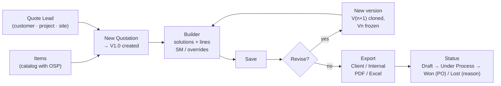

# Quotation Module (Quote Manager) — Technical Reference

**Company:** Tasktel Technologees Pvt Ltd
**Shipped in:** commit `9205e4c` — "Add Quotation module and Sales lead Funnel"
**Lives in:** the existing Admin/Technician portal (`ADMIN_TECHNICIAN/ADMIN DASH`) + `backend-unified`. It is **not** a separate app. No new server, port, or login.

---

## 1. What it is

A Configure-Price-Quote tool inside the Admin Dash. Quote Managers keep an item catalog with cost prices (OSP). They create quote leads (customer + project + site) and build versioned quotations from them. A quotation is organised into solutions, such as a room, floor or system. The selling price is calculated from cost using a Standard Multiplier (SM). Managers export a client copy (no cost or margin) or an internal copy (with cost and margin) as PDF or Excel. Each deal is then tracked to Won (with PO) or Lost (with reason).

The module is purely additive. It adds new tables, new routes and new pages, and it touches no existing table, column or constraint. **Quote leads are separate from Sales `leads`.** The two are never linked, and nothing in the module reads or writes the Sales pipeline.

---

## 2. Who can use it

Prices and margins are confidential, so only two kinds of session get in. Both are checked **live against the database on every request**, never trusted from the JWT (`backend-unified/middleware/quoteAuth.js`).

| Who | Mode | What they can do |
|---|---|---|
| Back-Office employee with the **Quote Manager** tag | `manager` | Full read/write: catalog, leads, quotes, versions, status, exports |
| **Super Admin** | `viewer` | Read-only view of everything, including exports. Assigns/removes the Quote Manager tag |
| Every other admin, Sales, Technician, Customer | — | Refused (403). No nav entry shown |

### Assigning a Quote Manager
1. The Super Admin opens **Back-Office** in the admin sidebar.
2. A **Quotations** column (visible only to the Super Admin) shows a **Quote Manager** toggle per employee.
3. Turning it on inserts a row in `quote_managers` (`PUT /api/quotes/managers/:backOfficeId`). Only active employees can be granted. Turning it off deletes the row. If the employee is removed, the grant is dropped too (`ON DELETE CASCADE`).

Other admins can never be given access. The `quotations` admin page maps to a module key that no `admin_permissions` row grants, so only the Super Admin passes `canAccessAdminPage`.

### How the UI decides what to show
- `GET /api/quotes/access` never returns 403. It returns `{ canAccess, mode }` and the UI uses that to show or hide the module.
- `useQuoteAccess()` (`quoteShared.js`) caches that answer per access token for the nav. The module pages pass `recheck: true` so that a grant or revoke made since login takes effect on the next page open.
- **Back-Office Quote Manager:** gets three extra nav entries in both the desktop Sidebar and the mobile BottomNav: **Quote Leads**, **Quotations** and **Items**.
- **Super Admin:** gets a single **Quotations** admin page with three tabs (Quotations / Quote Leads / Items) and a "Super Admin · view only" badge.

---

## 3. End-to-end workflow



### Step 1: Build the catalog (Items page)
- **Categories** are folders that items are filed under. You can create, rename and delete them; a category that still holds items can't be deleted. Names are unique, ignoring case.
- **Items** have Category, Series, **Model Name** (unique, ignoring case, and used as the item's identity), HSN code, **Price**, GST % (default 18) and Remark.
  - **Price is the cost (OSP)**, not the selling price. The selling price is worked out inside each quote.
- The list is searchable (model, series, HSN, remark, category), filterable by category, and paged at 50 rows. Rows can be multi-selected for bulk delete (up to 1000 at a time).
- **Excel import:**
  - **Download template** gives the columns `Category, Series, Model Name, HSN Code, Price, GST %, Remark`.
  - The header row is found automatically in the first 10 rows, so a title row can sit above it. Common alternate headers are accepted (e.g. `OSP`/`Cost` → Price, `HSN/SAC` → HSN Code, `Product` → Model Name).
  - A preview shows the row count, valid rows, rows with errors, and new categories that will be created.
  - The import is **all-or-nothing**: any invalid row rejects the whole file and every row's error is listed. Missing categories are created. An existing model name is **updated in place**. A model that appears twice in one file keeps the last row. The limit is 5000 rows per file.
- **Excel export** downloads the current catalog in the same column layout, so it can be edited and re-imported.
- Deleting an item never changes saved quotes. Each quote line keeps its own copy of the item's fields.

### Step 2: Create a Quote Lead (Quote Leads page)
- Fields: **Customer** (required), Project, Location / Site.
- The list shows the creator, the quotation count, how many are won, and the last activity. Clicking the quote count opens Quotations filtered to that customer.
- A lead with quotations can't be deleted. Delete its quotations first.

### Step 3: Start a quotation
- **New Quotation** on a lead row creates the quote with **V1.0**. V1.0 starts with one empty solution and the default Notes & Terms, and the builder opens on it straight away.
- The Quotations page's **New Quotation** button sends you to Quote Leads, because every quote must belong to a lead.

### Step 4: Build it (Quote Builder)

**Header settings (sticky bar):**
- **Project Ref**, free text (e.g. `TTPL/BLR/INS/AV/26-27/NRS/041026-a`).
- **Date** of the quotation.
- **Universal SM**, the Standard Multiplier for the whole quote (default `0.85`). The bar shows the matching margin (`0.85` → 15% margin).
- **Round up to** ₹1 / ₹10 / ₹100 / ₹1000 (default ₹100).
- **Costing** toggle, which shows or hides the OSP and SM columns, the margin column and the cost KPIs on screen. This only affects the screen; exports are chosen separately.
- **KPI tiles:** OSP Cost, Supply Price, Services Price, GST, Margin (₹ and %) and Grand Total.

**Solutions (sections):**
- Each solution has a free-text name (e.g. *48 Seater Boardroom*, *Ground Floor Lobby*, *Digital Signage Network*). This one structure covers rooms, floors and solutions.
- A solution's menu offers Move up/down, **Duplicate solution** (copies every line) and Delete.
- **Add item** opens a catalog picker with search plus a category filter. Use ↑/↓ and Enter to add, and the same item can be added more than once. The item's model, series, category, HSN, OSP, GST and remark are **copied** onto the line.
- **Add installation / service** adds a free-text service line with its own qty, OSP and GST.
- Within a solution, supply lines are listed first, then a divider, then **Installation & Services** lines.
- **Add Pre-Installation & PPM** adds at most one special block, "Pre-Installation Planning & Migration Services". Every line in it is a service line, and new solutions are always inserted above it.

**Per-line editing:**
- Qty, HSN, description, GST % and OSP Unit (when costing is shown).
- **SM override** on a line replaces the universal SM for that line.
- **Unit Price override:** typing a price fixes it, ignoring SM entirely.
- Lines with either override are tagged **Indiv**, the rest **Univ**. Clicking the *Indiv* tag clears both overrides and puts the line back on the universal SM.
- Lines can be reordered with the up/down arrows and removed.

**Below the solutions:**
- **Investment Summary:** one row per solution with Supply / Services / GST, then Grand Total (Supply + Installation + PPM), Grand Total (All Inclusive), and the SM margin row when costing is shown.
- **Notes & Terms:** free text saved with each version. New quotes start with five default exclusions (electrical, civil, carpentry/false ceiling, IT infrastructure, additional mounting structures).

**Saving:**
- Save with the **Save** button or **Ctrl/⌘ + S**. The whole version (settings + solutions + lines) is sent and replaces what was stored.
- An "Unsaved changes" badge shows while there are edits. Closing the tab warns before discarding them.
- Navigating to another page without saving keeps your edits in memory. They are restored the next time you open that version, unless someone saved it in the meantime.
- **Conflict protection:** each save sends the `updated_at` that was loaded. If another user saved first, the save is refused with *"Someone else saved this quotation while you were editing"* and you are offered a reload.

### Step 5: Versions (V1.0, V2.0, …)
- The **version picker** lists every version with its grand total, date and editor. Only the **latest** version is editable, and older versions open read-only for viewing and exporting.
- **New version** copies the latest saved version into V(n+1), including SM, rounding, notes, every solution and every line. The previous version is frozen, and the quote's status is reset to **Draft**.
- Save your edits before creating a new version, because the copy is taken from what is saved.

### Step 6: Status / deal outcome
| Status | Label | Rules |
|---|---|---|
| `draft` | Draft | Default |
| `sent` | Under Process | With client / negotiating |
| `won` | Won | Requires **PO number** and **PO date** |
| `lost` | Lost | Requires a reason: Competitor price, Budget cancelled, Timeline mismatch, Scope changed, No response, or Other (free text) |

- A **Won** or **Lost** quote is **locked**: it can't be saved and no new version can be made from it. **Reopen (Under Process)** unlocks it.
- The Status menu also holds **Delete quotation**, which deletes every version permanently.
- The Quotations list shows each quote's latest version with Grand Total, Margin %, status and PO number. It has status tabs and status tiles (count and value per status) plus a search over customer, project and ref.

---

## 4. Costing engine

The same pure-function engine exists in two places, and both are pinned by `backend-unified/tests/quoteEngine.test.js`:
- `backend-unified/services/quoteEngine.js` computes the totals stored on save.
- `ADMIN DASH/src/components/quotes/quoteEngine.js` does the live math in the UI.

**Change one, change both.**

```
SM (effective)  = line.sm_override  ?? quote.sm
Unit Price      = line.price_override
                  ?? ceil( (OSP ÷ SM) / rounding_step ) × rounding_step      (0 if OSP ≤ 0)
Amount          = qty × Unit Price
GST             = Amount × gst_rate %
Line Total      = Amount + GST
OSP Total       = qty × OSP
Margin ₹        = Amount − OSP Total
Margin %        = Margin ₹ ÷ Amount × 100
```

Totals are kept per solution and for the whole version, split by line type:

```
supply_osp / supply_price       ← lines with line_type = 'supply'
services_osp / services_price   ← lines with line_type = 'service' (incl. all PPM lines)
Subtotal     = supply_price + services_price
Grand Total  = Subtotal + gst_total
Margin ₹     = Subtotal − (supply_osp + services_osp)
```

Precision details:
- Money is rounded to 2 decimals and SM to 4 decimals, matching the DB column scale, so the cached totals equal what is stored.
- The round-up ignores float noise, so an exact multiple never jumps a step.
- SM must be between 0.01 and 2.
- Totals of ₹1e13 or more are rejected.

---

## 5. Exports

They are available from the **Export** menu on any version, including frozen ones and in read-only mode. If there are unsaved edits, the export asks before using what's on screen.

| | Client copy | Internal copy |
|---|---|---|
| Shows | Selling prices, GST, totals | Everything in the client copy plus OSP Unit/Total, SM, Margin ₹/%, Univ/Indiv mode |
| Marked | — | "INTERNAL · CONFIDENTIAL", `_INTERNAL` filename suffix |

- **PDF:** opens a print-ready page in a new window, so popups must be allowed. It has the TaskTel logo, a header (Project, Customer, Date, Version, Project Ref), a table per solution with an Installation & Services divider, the Investment Summary, the amount in words (Indian numbering), the notes, and an "Authorised Signatory" block.
- **Excel (.xlsx via ExcelJS, loaded on demand):** two sheets.
  - **Investment Summary:** a row per solution, Grand Total, amount in words, the SM margin row (internal only), and the notes.
  - **Bill of Materials:** every line per solution with a subtotal per solution, then the Grand Total. OSP columns are tinted green on the internal copy. Amounts use the Indian number format (₹1,00,000), and the page is set to landscape A4 fit-to-width.
- Filename: `Quotation_<Customer>_V<n>[_INTERNAL].xlsx`.

---

## 6. Data model (migration `045_quotations.sql`)

| Table | Purpose | Notes |
|---|---|---|
| `quote_managers` | Back-Office employees with the tag | PK `back_office_id` → `back_office` (cascade), `granted_by` → `admins` |
| `quote_categories` | Catalog folders | Unique on `lower(btrim(name))` |
| `quote_items` | Catalog items | `price` = OSP; unique on `lower(btrim(model_name))`; category FK is `RESTRICT` |
| `quote_leads` | Customer / project / site | Independent of Sales `leads` |
| `quotes` | One quotation | `status` ∈ draft/sent/won/lost; DB `CHECK`s force PO no. + date when won and a reason when lost; lead FK `RESTRICT` |
| `quote_versions` | V1, V2, … | Unique `(quote_id, version_no)`; holds `sm`, `rounding_step`, `notes`, `quote_date` and **cached totals** for the list view |
| `quote_sections` | Solutions / PPM block | `kind` ∈ solution/ppm; cascade from version |
| `quote_lines` | Line items | Copied item fields; `sm_override`, `price_override`; `item_id` → `SET NULL` if the item is deleted |

All tables have `updated_at` triggers. The module's tables are **deliberately not** in the `config/databaseClient.js` allowlist. `services/quoteService.js` talks to the `pg` pool directly, so nothing outside the module can reach these tables through the shared query builder.

Server-side limits: 100 solutions per version, 500 lines per solution, 5000 import rows, 1000 items per bulk delete, and 200 items per catalog page request.

---

## 7. API (`/api/quotes`)

Every route except `/access` and `/managers*` passes `requireQuoteAccess`. Write routes also need `requireQuoteManager`; a Super Admin calling them gets *"Quotations are read-only for this account"*.

| Method | Path | Who | Action |
|---|---|---|---|
| GET | `/access` | any signed-in | `{ canAccess, mode }` (never 403) |
| GET | `/managers` | Super Admin | IDs of tagged Back-Office employees |
| PUT | `/managers/:backOfficeId` | Super Admin | `{ enabled: true/false }` |
| GET | `/categories` | read | List with item counts |
| POST / PATCH / DELETE | `/categories[/:id]` | manager | Create / rename / delete (only when empty) |
| GET | `/items?search=&category_id=&page=&limit=` | read | Paged catalog |
| POST | `/items` | manager | Create item |
| PATCH | `/items/:id` | manager | Update item |
| POST | `/items/import` | manager | `{ rows: [...] }`, all-or-nothing upsert by model name |
| POST | `/items/delete` | manager | `{ ids: [...] }` bulk delete |
| GET | `/leads?search=` | read | Leads with quote/won counts |
| POST / PATCH / DELETE | `/leads[/:id]` | manager | Create / edit / delete (only with no quotes) |
| GET | `/?search=&status=` | read | Quotes with their latest version |
| POST | `/` | manager | `{ lead_id, project_ref? }` → creates the quote + V1 |
| GET | `/:id` | read | Quote + version list |
| DELETE | `/:id` | manager | Delete quote and all versions |
| PATCH | `/:id/status` | manager | `{ status, po_number?, po_date?, lost_reason? }` |
| POST | `/:id/versions` | manager | Clone latest → V(n+1) |
| GET | `/:id/versions/:versionId` | read | Full version (sections + lines, `is_latest`) |
| PUT | `/:id/versions/:versionId` | manager | Save whole version; send `base_updated_at` for conflict detection |

Save-time errors return **409**:
- the quote is Won/Lost (*"Reopen it to make changes"*)
- the version is not the latest (*"Older versions are read-only"*)
- someone else saved first

Validation errors return **400** with a readable message. For imports, the per-row errors are in `details`.

---

## 8. File map

```
backend-unified/
├── migrations/045_quotations.sql      # schema (section 6)
├── middleware/quoteAuth.js            # manager / viewer resolution, live DB checks
├── routes/quotes.js                   # /api/quotes routes (mounted in server.js)
├── services/quoteService.js           # validation, catalog, leads, quotes, versions, import
├── services/quoteEngine.js            # costing formulas (server copy)
└── tests/quoteEngine.test.js          # engine + validation unit tests

ADMIN_TECHNICIAN/ADMIN DASH/src/
├── components/quotes/
│   ├── QuoteWorkspace.jsx             # entry: access gate, admin tabs vs Back-Office routed pages
│   ├── QuotationsPage.jsx             # quote list, status tiles/tabs, search
│   ├── QuoteBuilder.jsx               # the editor (settings, solutions, lines, versions, status, exports)
│   ├── QuoteLeadsPage.jsx             # quote leads CRUD + "New Quotation"
│   ├── QuoteItemsPage.jsx             # catalog, categories, Excel import/export
│   ├── QuoteManagerToggle.jsx         # Super Admin toggle on the Back-Office roster
│   ├── quoteEngine.js                 # costing formulas (UI copy — keep in sync)
│   └── quoteShared.js                 # nav items, access hook, formatters, status metadata
├── services/quoteApiService.js        # REST client for /api/quotes
├── utils/quoteExport.js               # client/internal PDF + Excel
└── utils/quoteItemsExcel.js           # catalog template, import parser, export
```

Wiring touched outside the module:
- `App.jsx`: the admin `quotations` page, plus Back-Office routing to the quote pages.
- `Sidebar.jsx`, `BottomNav.jsx` and `config/adminNavItems.js`: nav entries.
- `AppContext.jsx`: the `quotations` page → module key.
- `BackOfficePage.jsx`: the Quote Manager column.

---

## 9. Deployment & operations

- **Database:** run `npm run db:migrate` in `backend-unified` to apply `045_quotations.sql`. It runs inside the migration transaction. No seed data is shipped, so the catalog starts empty; load it with the Items page's Excel import.
- **Backend:** pushing to `main` redeploys `backend-unified` on Railway. The router is mounted at `/api/quotes` in `server.js`.
- **Admin frontend:** `npm run build` in `ADMIN DASH`, then upload the build to cPanel. ExcelJS is loaded only when an Excel import or export runs.
- **Tests:** run `npm test` in `backend-unified` (`quoteEngine.test.js`) before pushing, since a push deploys to production.
- **First-time setup in production:**
  1. The Super Admin opens Back-Office and toggles **Quote Manager** on for the right employees.
  2. Those employees sign in again or refresh, and Quote Leads / Quotations / Items appear in their nav.
  3. A Quote Manager imports the item catalog from Excel.
  4. Create a quote lead, then **New Quotation**.
